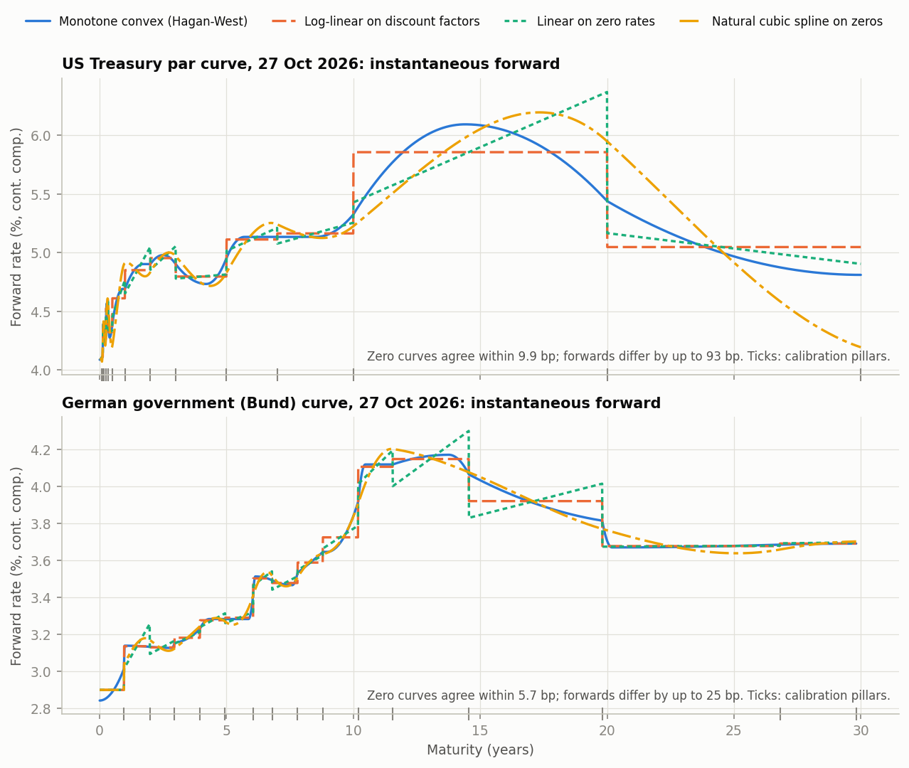
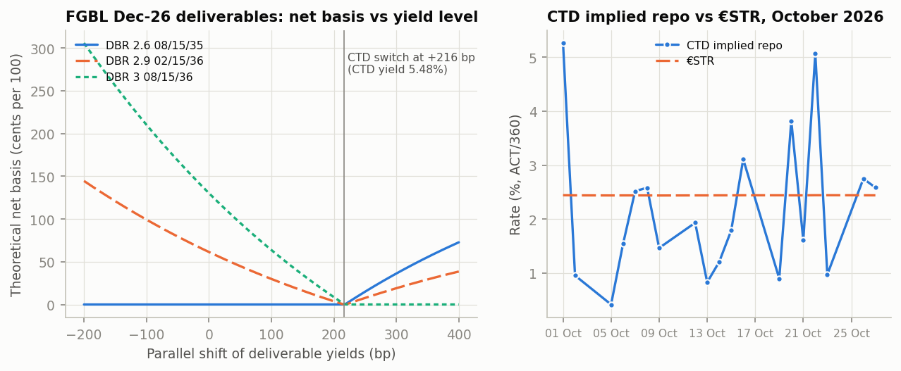

# Yield curves, bond risk and Euro-Bund futures basis

[](https://github.com/tancredeg/yield-curve-bootstrap/actions/workflows/ci.yml)


The US Treasury and German Bund curves are calibrated exactly to public market quotes under four interpolation schemes, including Hagan-West monotone convex, and then used to measure how interpolation changes forwards and risk, to break bond-portfolio risk down by key rate, to extract curve factors by PCA, and to analyse the Euro-Bund futures basis (conversion factors, CTD, net basis, implied repo).

## Key results

<!-- results:key -->
| Question | Result (as of 27 Oct 2026) | Reading |
|---|---|---|
| R1. Does the interpolation scheme matter if every scheme reprices the curve exactly? | Zero curves agree within 9.9 bp; instantaneous forwards differ by up to 93 bp (USD) and 25 bp (EUR); USD 15y5y forward spread 28.5 bp | Yes for anything forward-starting: the scheme is a pricing and risk decision, not a plotting detail. |
| R2. What does a single DV01 hide? (EUR 100mn DBR 3 08/15/36 vs a barbell with the same MV and DV01) | Same MV and DV01 (EUR 83.7k/bp); 84% of the bullet's DV01 on the 10y key vs 71% of the barbell's on 2y+30y; steepener P&L gap EUR 1.51mn | Curve risk needs key-rate or bucketed DV01; the bucket split also depends on the interpolation scheme. |
| R3. How many factors drive daily curve moves? (2023-2026) | Level / slope / curvature: 83.0 / 10.7 / 2.9% (USD), 80.6 / 10.8 / 4.7% (EUR) | Three factors carry about 96% of the variance, the basis for factor hedging and scenario design. |
| R4. Which Bund is cheapest to deliver into FGBL Dec-26? (2026-10-27) | DBR 2.6 08/15/35: implied repo 2.58% vs €STR 2.44%, net basis -1.6 c; CTD switch after a +216 bp parallel rise | Below the 6% notional coupon the lowest-duration bond is CTD; over the month its implied repo averaged within one daily standard deviation of €STR. |

Validation: every calibration instrument reprices to 6e-12 bp under each scheme; 1459 Bundesbank accrued amounts and yields are reproduced to 6e-14 per 100 and 5e-05 bp; 43 of 43 Eurex conversion factors are reproduced to six decimals.
<!-- /results:key -->





Full tables, the key-rate and PCA figures, and the reading of each result: [docs/results.md](docs/results.md). Every number above and in that file is written by `scripts/run_results.py`; the CI re-runs it and fails if a published number differs.

## Methodology

**Data** (frozen in `data/sample/`, SHA-256 in `MANIFEST.json`, as of 27 October 2026, histories from January 2023)

| Source | Content | Use |
|---|---|---|
| US Treasury, daily par yield curve | 14 constant-maturity par yields, bond-equivalent (semiannual) basis | USD curve, USD PCA |
| Deutsche Bundesbank, prices and yields of listed Federal securities | Clean and dirty reference prices, yields, issue volumes, per ISIN and day | EUR curve, out-of-sample bonds, futures basket prices |
| Eurex, deliverable bonds and conversion factors; FGBL daily statistics | Baskets and published conversion factors of FGBS, FGBM, FGBL, FGBX; daily settlement prices and open interest | Futures basis |
| ECB Data Portal | AAA euro area spot curve (Svensson, continuous compounding); €STR | EUR PCA; financing rate for carry |

**Curves.** One pillar per calibration instrument; the pillar zero rates solve the square system "model price = market price" for all instruments at once (MINPACK hybrid Powell), so the curve used for pricing and risk is the curve that reprices the inputs, under the same scheme.

- USD: the 14 Treasury par points are par instruments on a regular semiannual grid (single payment below six months).
- EUR: conventional Bunds, Bobls and Schatz with dated cash flows, ACT/ACT ICMA accrual, T+2 TARGET settlement, short and long first coupons. Selection rule fixed in advance: for each of 15 target tenors from 1 to 30 years, the nearest eligible bond (non-zero coupon, at least six months to maturity, at least EUR 10bn outstanding, within 6 months of the target up to 10 years and 2 years beyond). Green and inflation-linked securities are excluded; every other conventional bond is out of sample and repriced off the curve.

**Interpolation schemes** (all exact at the pillars; time in ACT/365F years, continuous compounding)

| Scheme | Forward curve | Locality |
|---|---|---|
| Linear on zero rates | Jumps at every pillar | Local |
| Log-linear on discount factors | Piecewise flat (equal to the discrete forwards) | Local |
| Monotone convex (Hagan and West, 2006), with the positivity amendment | Continuous, positive when discrete forwards are positive | Local within two intervals |
| Natural cubic spline on zero rates | Smooth zeros, continuous forwards except at the first pillar | Global (counter-example) |

**Risk.** Parallel DV01 and key-rate DV01 (triangular zero-rate bumps on 1-30 years, which add up to a parallel shift; Ho, 1992); bucketed DV01 by bumping each calibration quote and recalibrating; ICMA yield duration and convexity checked against finite differences. Bond positions carry a constant spread to the curve so they are marked at their market price.

**PCA.** Eigen-decomposition of the covariance of daily changes (bp) of the Treasury par curve and of the ECB AAA spot curve, with signs fixed to read as level, slope and curvature, and stability measured on the two halves of the sample.

**Bund futures.** Eurex conversion factor formula for EUR bonds (6% notional coupon); gross basis, carry, net basis and implied repo on the cash-and-carry identities with ACT/360 money-market interest and €STR as the financing rate; CTD as the bond with the highest implied repo; CTD switch under parallel yield shifts from the theoretical futures price `min(forward price / CF)`.

**Scenarios.** The six BCBS IRRBB standardised shocks of Basel Framework SRP31 with the July 2024 shock sizes (EUR 225/350/200 bp, USD 200/300/225 bp for parallel/short/long), applied to the zero curve as continuous functions of maturity.

**Limits (what the model does not do)**

- No swap or OIS curve: no free official source of OIS term quotes was found, so swaps are not priced and the curves are government curves only (no basis, no multi-curve).
- The Treasury par yields are themselves a smoothed fit of on-the-run securities (monotone convex since December 2021); the USD curve is consistent with those par points, not with individual Treasuries.
- The Bund curve is an exact fit: it passes through each calibration bond's idiosyncratic richness or cheapness. Out-of-sample residuals mix fitting error with liquidity, specialness and coupon effects.
- Payment dates are not business-day adjusted; Bunds have no ex-coupon period, so none is modelled.
- Futures: the seller's delivery options are not valued, specific (special) repo is not observed and €STR is a proxy for general collateral, and the bond prices (Bundesbank reference prices of the Frankfurt Stock Exchange) and the futures price (Eurex settlement, minute before 17:15 CET) are separate fixings, which makes the daily implied repo noisy.
- The PCA runs on smoothed curves, which concentrates variance in the first factors.
- The IRRBB shocks are applied to bond portfolios as a sensitivity exercise: no balance sheet, no behavioural assumptions, no post-shock floor.
- Monotone convex is only piecewise smooth in its inputs: its bucketed risk is computed with 0.01 bp bumps (see R2).

## Reproduce

```bash
pip install -e ".[dev]"
python scripts/run_results.py
```

The first command installs the package with pinned dependencies; the second rebuilds every figure, table and number from `data/sample/` in under a minute. `pytest` runs the test suite (coverage gate 80% on `src/`), `python scripts/run_results.py --check` verifies that the committed outputs are current, and [notebooks/demo.ipynb](notebooks/demo.ipynb) walks through the four results. To refresh the data for another date: `pip install -e ".[fetch]"`, then `python scripts/fetch_data.py --asof YYYY-MM-DD` and `python scripts/freeze_sample.py`.

## Code structure

```
src/ratescurve/
    conventions.py    TARGET2 calendar, ACT/365F, ACT/360, ACT/ACT ICMA
    instruments.py    dated fixed-rate bonds (irregular first coupons), par instruments
    interpolation.py  linear zero, log-linear DF, monotone convex, natural cubic spline
    curve.py          discount curve, shifted curve, parallel and key-rate bumps
    calibration.py    exact global calibration of pillar zero rates
    bonds.py          curve pricing, ICMA yields, duration, convexity, DV01
    markets.py        USD and EUR curves from the sample, bond selection, out-of-sample residuals
    risk.py           parallel, key-rate and bucketed DV01
    pca.py            principal components of curve changes
    futures.py        Eurex conversion factor, basis, carry, implied repo, CTD switch
    scenarios.py      BCBS SRP31 interest rate shocks
    data.py           sample loaders, checksums, Bundesbank and first-coupon parsers
scripts/
    fetch_data.py     download raw public data into data/raw/ (git-ignored)
    freeze_sample.py  build data/sample/ and its checksummed manifest
    run_results.py    every figure, table and number of the README and docs/results.md
tests/                invariants, published-value replication, oracles (QuantLib, tf-quant-finance), regression
notebooks/demo.ipynb  end-to-end walkthrough
docs/                 results.md, key_results.json, figures/
AUDIT.md              initial code audit and its resolution; PROGRESS.md: work log
```

## References

- P. S. Hagan and G. West (2006), "Interpolation methods for curve construction", *Applied Mathematical Finance* 13(2), 89-129; (2008), "Methods for constructing a yield curve", *Wilmott Magazine*, May, 70-81.
- T. S. Y. Ho (1992), "Key rate durations: measures of interest rate risks", *Journal of Fixed Income* 2(2), 29-44.
- R. Litterman and J. Scheinkman (1991), "Common factors affecting bond returns", *Journal of Fixed Income* 1(1), 54-61.
- G. Burghardt, T. Belton, M. Lane and J. Papa, *The Treasury Bond Basis*, 3rd ed., McGraw-Hill.
- Eurex, [Euro-Bund Futures contract specifications](https://www.eurex.com/ex-en/markets/int/long-term-interest-rates/fix/government-bonds/Euro-Bund-Futures-137298) and [conversion factor calculation for EUR-denominated bonds](https://www.eurex.com/resource/blob/4611900/46480991b357a3fdfb059591ecc2187b/data/conversion-factor-calculation-EUR-denominated-bonds.pdf).
- US Treasury, [Treasury yield curve methodology](https://home.treasury.gov/policy-issues/financing-the-government/interest-rate-statistics/treasury-yield-curve-methodology).
- Deutsche Bundesbank, [Prices and yields of listed Federal securities](https://www.bundesbank.de/en/statistics/money-and-capital-markets/interest-rates-and-yields/prices-and-yields-of-listed-federal-securities).
- ECB, [euro area yield curves](https://data.ecb.europa.eu/data/datasets/YC) and [euro short-term rate](https://data.ecb.europa.eu/data/datasets/EST).
- Basel Committee on Banking Supervision, [SRP31 Interest rate risk in the banking book](https://www.bis.org/basel_framework/chapter/SRP/31.htm) and [Recalibration of shocks in the IRRBB standard (d578, July 2024)](https://www.bis.org/bcbs/publ/d578.pdf).
- ICMA, Primary Market Handbook, Rule 251 (ACT/ACT ICMA accrued interest).
