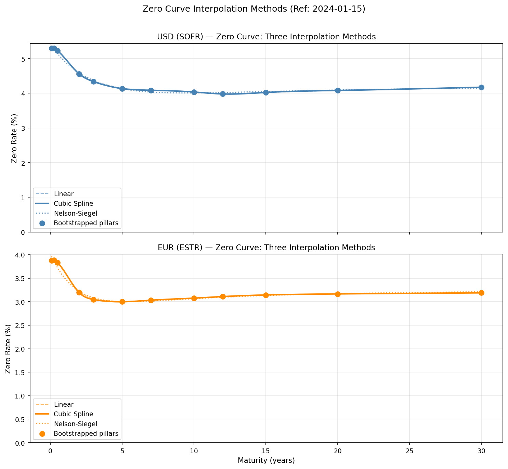
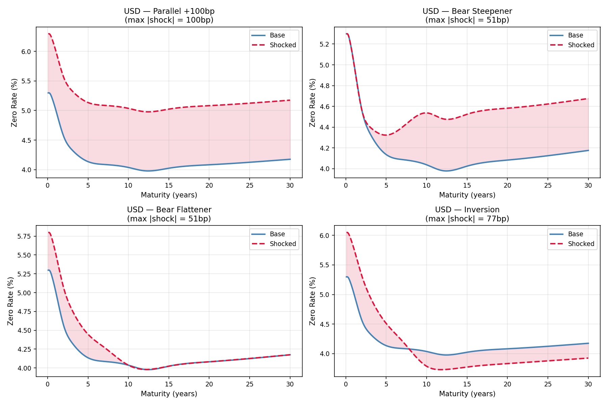
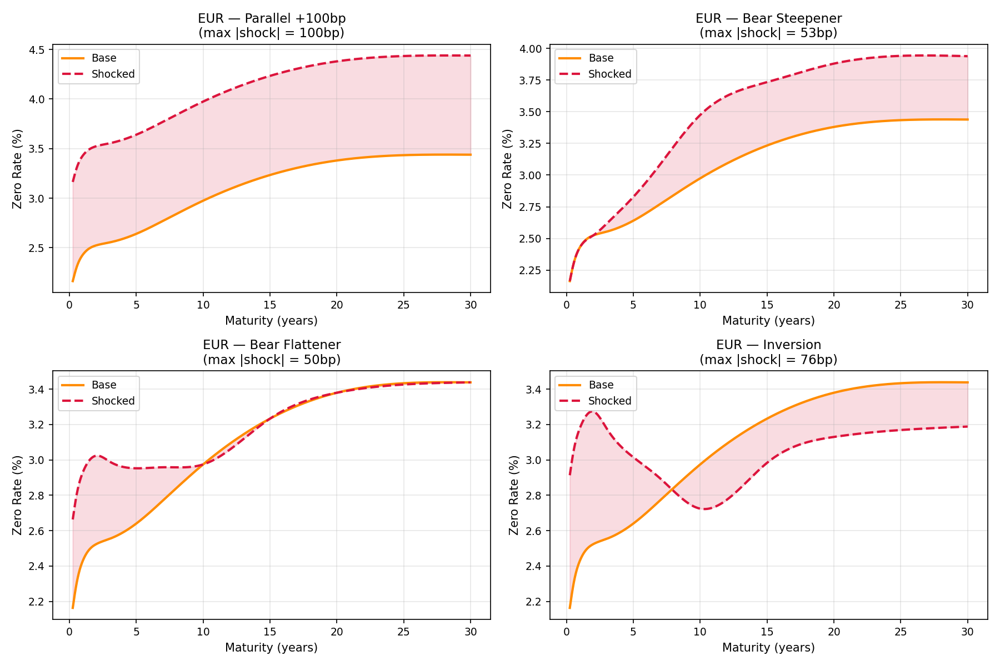
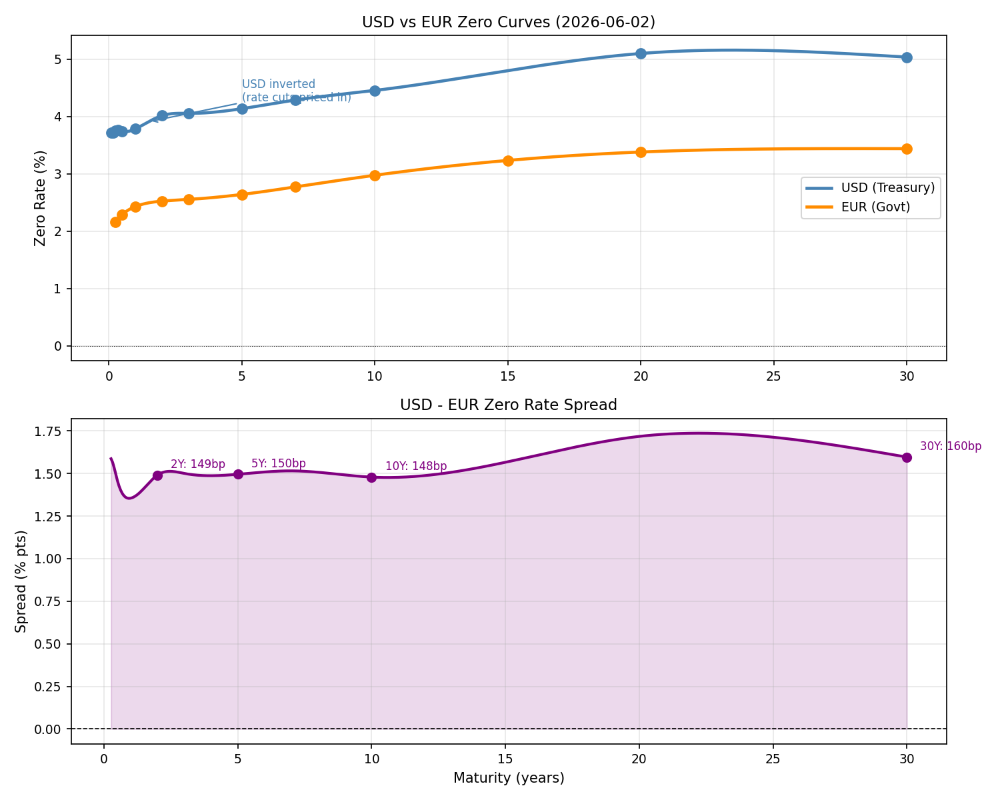

# Yield Curve Bootstrap & Rates Pricing — USD vs EUR

Construction de courbes zéro à partir de **données de marché réelles**,
pricing de bonds et swaps, analyse de scénarios IRRBB, comparaison
cross-currency. Pipeline reproductible en une commande.

---

## Sources de données

| Devise | Source | Instruments | Méthode |
|--------|--------|-------------|---------|
| USD    | US Treasury (`home.treasury.gov`) — Daily Par Yield Curve | CMT par yields, 11 tenors (1M→30Y) | Bootstrap |
| EUR    | BCE (`data-api.ecb.europa.eu`) — Yield Curve dataset | Spot rates AAA govt, modèle Svensson | Ingestion directe |

Données extraites par API publiques, sans clé. Aucune donnée synthétique
dans le pipeline final ; les valeurs sont datées et tracées dans
`data/metadata.json`.

**Choix méthodologique côté EUR** : la BCE publie déjà la courbe zéro
ajustée par Svensson sur les govvies AAA. Bootstrapper par-dessus
introduirait du bruit redondant. Le bootstrap reste démontré côté USD
sur de vrais rendements du Trésor ; côté EUR, le projet montre la
capacité à ingérer et exploiter une courbe institutionnelle. Cette
asymétrie est volontaire et documentée.

---

## Architecture

```
fetch_market_data.py  →  data/usd_yields.csv
                         data/eur_zeros.csv
                         data/metadata.json
            ↓
yield_curve.py  (8 sections)
   ├── 0. Loading                 ── CSVs → dicts
   ├── 1. USD short end           ── deposit-style bootstrap (≤6M)
   ├── 2. USD long end            ── par-yield bootstrap (≥1Y, semi-ann)
   ├── 3. Verification            ── independent repricing (residual <1e-6)
   ├── 4. Interpolation           ── log-linear, cubic, Nelson-Siegel
   ├── 5. Bond pricing            ── price, YTM, D_mac, D_mod, DV01, convexity
   ├── 6. Swap pricing            ── par rate, NPV, signed position DV01
   ├── 7. Scenarios               ── 4 IRRBB shocks, P&L by scenario
   └── 8. USD vs EUR comparison   ── data-driven commentary
            ↓
figures/   (4 PNGs)
```

---

## Résultats

### Courbes zéro et méthodes d'interpolation



Trois méthodes superposées sur les piliers bootstrappés : interpolation
log-linéaire (utilisée dans le bootstrap), spline cubique naturelle
(utilisée pour le pricing), et Nelson-Siegel calibré par grid-search
sur τ avec OLS analytique sur (β₀, β₁, β₂).

### Analyse de scénarios IRRBB — USD



### Analyse de scénarios IRRBB — EUR



Quatre scénarios standards : choc parallèle ±100bp, bear steepener,
bull flattener. P&L calculé sur portfolio de bonds + swaps, en
revalorisant chaque instrument sur la courbe choquée.

### Comparaison USD vs EUR



---

## Points techniques défendables

- **Bootstrap vérifié indépendamment.** Section 3 reprice chaque
  instrument input avec les piliers finaux et mesure le résidu en bp.
  Résidu max < 0.01bp sur toutes les maturités → bootstrap exact à
  la précision machine.

- **Conventions de duration cohérentes.** D_mac, D_mod et convexité
  sont calculées sous une **unique** base de rendement (continue ou
  périodique au coupon_freq), jamais mélangées. La relation
  dP/P = −D_mod·dy + ½·C·dy² est vérifiée par finite-difference dans
  les tests (tol. 1e-5).

- **DV01 position-conscient.** Le swap DV01 reprice la **position**
  réelle (taux fixe contractuel, direction payer/receiver), pas un
  swap ATM proxy. DV01 signé : payer positif (gain sur +1bp), receiver
  négatif.

- **Nelson-Siegel calibré par grid-search.** Le fit joint L-BFGS-B
  laissait τ figé à son initialisation (problème classique d'échelle
  du gradient). Remplacé par grid-search sur τ + OLS linéaire sur les
  βᵢ à chaque nœud — méthode textbook, robuste, τ fitté réellement.

- **Pillars de remplissage 12Y/15Y.** Sans pillars intermédiaires entre
  10Y et 20Y, le bootstrap 20Y subit un biais d'extrapolation plat de
  ~64bp (mode d'échec connu). Documenté et fixé.

---

## Tests

22 tests d'invariants mathématiques (pytest), pas seulement « le code
tourne » :

- Exactitude algébrique du DF de dépôt : P = 1/(1+r·T)
- Repricing au pair de chaque instrument input (résidu < 1e-6)
- Antisymétrie payer/receiver : NPV_payer = −NPV_receiver
- Identité jambe flottante : V_float = N·(1−P(0,T))
- Signe DV01 payer (>0), receiver (<0), magnitude égale
- Conventions de duration distinctes et cohérentes
  - continuous : D_mod = D_mac
  - semiannual : D_mod = D_mac/(1+y/2)
  - annual : D_mod = D_mac/(1+y)
- Identité DV01 = D_mod·Price·1e-4
- Convexité vs finite-difference du YTM (rel_tol 1e-4)
- Mismatch convention/coupon_freq lève ValueError
- Extrapolation interdite hors piliers
- Choc parallèle +100bp décale chaque zéro de +100bp
- NS τ fitté (pas pinned à l'init), RMSE < 10bp
- Ingestion ECB cohérente (annual → continuous)
- Tests d'intégration sur CSVs réels (skip si data/ absent)

```
22 passed in ~3s
```

---

## Reproduction

Prérequis : Python ≥3.10.

```bash
# 1. Setup environnement
python -m venv .venv
.venv/bin/python -m pip install --upgrade pip
.venv/bin/python -m pip install -r requirements.txt -r requirements-dev.txt

# 2. Récupérer les données réelles (US Treasury + ECB)
.venv/bin/python fetch_market_data.py

# 3. Pipeline complet
.venv/bin/python yield_curve.py

# 4. Tests
.venv/bin/python -m pytest -v
```

Sous Windows PowerShell, remplacer `.venv/bin/python` par
`.venv\Scripts\python.exe`.

`fetch_market_data.py` essaye plusieurs formats d'URL (CSV récent,
XML héritage, plusieurs noms de paramètres) et écrit des fichiers
`data/_debug_*.txt` en cas d'échec pour faciliter le diagnostic.
Un fallback manuel est imprimé si toutes les sources échouent.

---

## Limitations honnêtes

1. **Single-curve framework.** Pas de basis OIS/IBOR. Acceptable pour
   les instruments utilisés ici (Trésor pur, OIS) ; à étendre pour des
   legs indexés EURIBOR/SOFR-3M.

2. **Cubic spline forward rates.** La spline cubique sur les zéros est
   C², mais sa dérivée (les forwards) peut osciller. C'est une propriété
   inhérente à la méthode, pas un bug. Nelson-Siegel est fourni comme
   alternative paramétrique smoother.

3. **EUR ingéré sans bootstrap.** Choix conscient (cf. plus haut). Le
   bootstrap est démontré côté USD sur 11 instruments réels.

4. **Bonds et swaps positions hypothétiques.** Les notionnels, taux
   fixes et maturités des positions analysées (Sections 5-6) sont
   illustratifs. La courbe sur laquelle elles sont valorisées est
   100% réelle.

---

## Structure des fichiers

```
.
├── fetch_market_data.py         # Téléchargement Treasury + BCE
├── yield_curve.py               # Pipeline complet (8 sections)
├── test_yield_curve.py          # 22 tests d'invariants
├── requirements.txt             # Dépendances runtime
├── requirements-dev.txt         # pytest
├── data/
│   ├── usd_yields.csv           # Treasury CMT, écrit par fetch
│   ├── eur_zeros.csv            # ECB spot rates, écrit par fetch
│   └── metadata.json            # Sources, dates, timestamp fetch
├── figures/                     # 4 PNG générés par yield_curve.py
└── .vscode/                     # Config IDE (interpreter, pytest)
```
