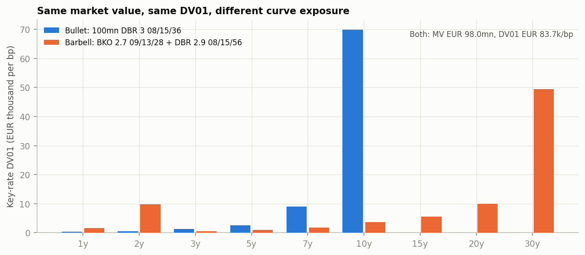
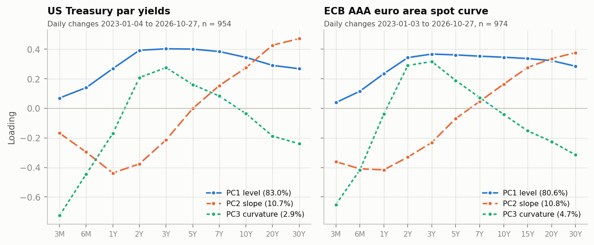

# Detailed results

Generated by `python scripts/run_results.py` from `data/sample/` (as of 2026-10-27). Do not edit by hand: the CI fails if this file differs from the script output.

## Validation against published values

| Check | Result |
|---|---|
| Calibration instruments repriced under each of the four schemes | 14 Treasury par points and 15 Bunds, max error below 1e-10 bp |
| Bundesbank accrued interest (dirty - clean) reproduced, ACT/ACT ICMA, T+2 | 1459 quotes (78 securities, 19 days), max error below 1e-12 per 100 |
| Bundesbank yields reproduced (ICMA annual compounding) | max error below 1e-04 bp (published to 1e-6 %) |
| Eurex conversion factors reproduced to six decimals | 43 / 43 (FGBL, FGBM, FGBS, FGBX) |

## R1. Instantaneous forwards by interpolation scheme

| Curve | Scheme | Max repricing error (bp) | Largest forward jump at a pillar (bp) | Forward range (%) | 5y5y fwd (%) | 10y10y fwd (%) | 15y5y fwd (%) | Out-of-sample RMS (bp) |
|---|---|---|---|---|---|---|---|---|
| USD | Monotone convex (Hagan-West) | < 1e-10 | 0.0 | 4.09-6.09 | 5.144 | 5.859 | 5.850 | - |
| USD | Log-linear on discount factors | < 1e-10 | 80.9 | 4.09-5.86 | 5.143 | 5.857 | 5.857 | - |
| USD | Linear on zero rates | < 1e-10 | 120.4 | 4.09-6.37 | 5.145 | 5.899 | 6.135 | - |
| USD | Natural cubic spline on zeros | < 1e-10 | 2.4 | 4.07-6.20 | 5.144 | 5.898 | 6.131 | - |
| EUR | Monotone convex (Hagan-West) | < 1e-10 | 0.0 | 2.84-4.17 | 3.518 | 4.009 | 3.900 | 2.94 |
| EUR | Log-linear on discount factors | < 1e-10 | 38.1 | 2.90-4.15 | 3.524 | 4.006 | 3.911 | 3.49 |
| EUR | Linear on zero rates | < 1e-10 | 47.0 | 2.90-4.30 | 3.523 | 4.008 | 3.921 | 3.44 |
| EUR | Natural cubic spline on zeros | < 1e-10 | 13.6 | 2.90-4.20 | 3.519 | 4.008 | 3.898 | 3.48 |

All four schemes reprice their own calibration instruments (14 Treasury par points, 15 Bunds) to within 1e-10 bp and their zero curves differ by at most 9.9 bp (USD) and 5.7 bp (EUR), yet their instantaneous forwards differ by up to 93 bp and 25 bp, and the USD 15y5y forward by 28.5 bp: the interpolation scheme is a forward-rate decision. Monotone convex is the only scheme with no forward jump at any pillar; on the 49 Bunds left out of the calibration, the lowest RMS yield error comes from Monotone convex (Hagan-West) (2.94 bp, against 3.44-3.49 bp for the others).

## R2. DV01, key-rate DV01 and bucketed DV01 of Bund portfolios

| Portfolio | Positions (EUR nominal) | MV (EUR mn) | DV01 (EUR k/bp) | KRD 1y | KRD 2y | KRD 3y | KRD 5y | KRD 7y | KRD 10y | KRD 15y | KRD 20y | KRD 30y | Convexity | IRRBB steepener P&L (EUR mn) | IRRBB flattener P&L (EUR mn) |
|---|---|---|---|---|---|---|---|---|---|---|---|---|---|---|---|
| Bullet | 100.0mn DBR 3 08/15/36 | 98.0 | 83.7 | 0.4 | 0.6 | 1.4 | 2.5 | 9.0 | 69.8 | 0.0 | 0.0 | 0.0 | 80 | -10.60 | +6.68 |
| Barbell | 60.2mn BKO 2.7 09/13/28, 43.6mn DBR 2.9 08/15/56 | 98.0 | 83.7 | 1.7 | 9.8 | 0.6 | 1.1 | 1.8 | 3.7 | 5.5 | 10.0 | 49.5 | 188 | -9.09 | +8.04 |

The barbell matches the bullet's market value and DV01 exactly, but 84% of the bullet's DV01 sits on the 10y key rate while 71% of the barbell's sits on the 2y and 30y keys; the single DV01 number hides a 1.51mn difference in P&L under the SRP31 steepener and a convexity of 188 against 80.

Bucketed DV01 of the bullet (sensitivity to each calibration Bund's yield, 0.01 bp bumps, EUR k/bp; the bullet is not a calibration bond and sits between DBR 2.6 08/15/35 and DBR 4 01/04/37):

| Scheme | Sum | Share on the two bracketing Bunds | Share on the four nearest | Sign changes | 1 bp bumps: sum of buckets vs joint shift |
|---|---|---|---|---|---|
| Monotone convex (Hagan-West) | 80.97 | 88.2% | 98.4% | 4 | 83.24 vs 80.97 (+2.81%) |
| Log-linear on discount factors | 80.96 | 98.1% | 98.5% | 3 | 80.96 vs 80.96 (+0.00%) |
| Linear on zero rates | 80.96 | 98.2% | 98.6% | 3 | 80.96 vs 80.96 (+0.00%) |
| Natural cubic spline on zeros | 80.97 | 80.9% | 95.5% | 8 | 80.97 vs 80.97 (+0.00%) |

Both linear schemes keep at least 98% of the risk on the two bracketing Bunds; monotone convex puts 88% there and 98.4% on the four nearest, while the natural spline spreads 4.5% beyond them with 8 sign changes. Monotone convex is only piecewise smooth in the quotes (its Hagan-West shape region can change under a 1 bp bump): 1 bp bucket DV01s add up to 83.24k against 80.97k for a joint 1 bp shift (+2.8%), so its bucketed risk is computed with 0.01 bp bumps. The bucket sums sit below the zero-curve DV01 (83.65k) because a 1 bp move in an annually compounded yield is 1/(1+y) bp of continuously compounded zero rate: 83.65k / (1 + 3.352%) = 80.94k.

## R3. Principal components of daily curve changes

| Curve | Window | Daily changes | PC1 % | PC2 % | PC3 % | Cumulative % | Factor daily sd (bp) | Loading similarity, 1st vs 2nd half (PC1/PC2/PC3) |
|---|---|---|---|---|---|---|---|---|
| USD Treasury par | 2023-01-04 to 2026-10-27 | 954 | 83.0 | 10.7 | 2.9 | 96.6 | 16.15 / 5.80 / 3.01 | 0.995 / 0.982 / 0.986 |
| EUR AAA spot (ECB) | 2023-01-03 to 2026-10-27 | 974 | 80.6 | 10.8 | 4.7 | 96.2 | 13.29 / 4.87 / 3.22 | 0.998 / 0.991 / 0.983 |

Three factors explain 96.6% (USD) and 96.2% (EUR) of the variance of daily curve changes, level alone 83.0% and 80.6%; the loadings estimated on each half of the sample have a cosine similarity of at least 0.98 (least stable factor: slope for USD, curvature for EUR). Both inputs are already smoothed (Treasury monotone convex par curve, ECB Svensson fit), which concentrates variance in the first factors; the shares are an upper bound for raw bond yields.

## R4. Euro-Bund futures: basket, conversion factors, CTD, net basis, implied repo

| Bond | ISIN | Conversion factor | Clean | Yield (%) | Modified duration | Gross basis (c) | Carry (c) | Net basis (c) | Implied repo (%) | CTD |
|---|---|---|---|---|---|---|---|---|---|---|
| DBR 2.6 08/15/35 | DE000BU2Z056 | 0.774902 | 94.62 | 3.314 | 7.65 | 1.2 | 2.8 | -1.6 | 2.58 | yes |
| DBR 2.9 02/15/36 | DE000BU2Z064 | 0.785735 | 96.58 | 3.332 | 7.81 | 65.0 | 5.2 | 59.7 | -2.74 |  |
| DBR 3 08/15/36 | DE000BU2Z072 | 0.784157 | 97.09 | 3.352 | 8.26 | 135.2 | 6.6 | 128.6 | -8.81 |  |

Inputs: FGBL Dec-26 daily settlement 122.09 (Eurex, 2026-10-27; open interest 1,926,477 contracts), Bundesbank reference prices of the same day with spot settlement 2026-10-29, delivery 2026-12-10 (42 days), €STR 2.440% as the financing rate for carry. Conversion factors are computed and equal Eurex's published values.

The DBR 2.6 08/15/35 is cheapest to deliver with an implied repo of 2.58% against €STR at 2.44%, 5.3 points above the next bond, and it was the CTD on all 19 trading days from 2026-10-01 to 2026-10-27. With every deliverable yielding below the 6% notional coupon, the conversion factor (a price at a 6% yield) understates every bond's value and understates the lowest-duration bond's the least, so that bond is cheapest; the CTD would switch to the DBR 2.9 02/15/36 after a +216 bp parallel rise in yields (CTD yield 5.48%).

Over the month the CTD implied repo minus €STR averaged -0.27 points with a daily standard deviation of 1.38 points. The bond prices (Bundesbank reference prices of the Frankfurt Stock Exchange) and the futures price (Eurex settlement, volume-weighted price of the minute before 17:15 CET) are separate fixings, and a 10-cent discrepancy between them moves the implied repo by 0.70 points: the daily dispersion corresponds to about 20 cents of price discrepancy, so single-day implied repos from these sources are not a trading signal. One contract carries EUR 94.22 of DV01, so the 100mn bullet of R2 is DV01-hedged by selling 888 contracts.
